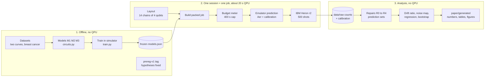

# qdrift: noise drift of quantum classifiers on IBM Heron

Research code and raw data for the paper **"Noise Drift of Simulator Trained Quantum Classifiers
on IBM Heron Processors"** by Pankaj Baid, Kartikey Gupta and Shreshtha Gupta.

Three small quantum classifiers are trained in a noiseless simulator and then frozen. They are
run on two IBM Heron r2 processors (`ibm_fez` and `ibm_kingston`) in ten sessions over 16.5
days. The study measures how accuracy, calibration and conformal coverage change between the
simulator, a calibration-based emulator and the hardware. It also asks which calibration
quantities explain the change, and which low-cost repairs recover it for each QPU second spent.
No quantum advantage is claimed, and tuned classical baselines are reported.

- Final paper: [`paper/final_simple/QML_research_paper.pdf`](paper/final_simple/QML_research_paper.pdf)
  (single-file LaTeX source next to it)
- Pre-registered hypotheses: [`preregistration.md`](preregistration.md) (git tag `prereg-v1`)
- Changes after the tag: [`notes/deviations.md`](notes/deviations.md)

**All the hardware data are in this repository.** Every number in the paper can be recomputed
from them on a laptop in a few minutes. You do not need an IBM account and no QPU time is used.

---

## Quick check: is everything working? (about 5 minutes, no IBM account)

These steps recompute the paper's results from the raw hardware counts saved in `data/raw/`.

### Step 0. Install `uv` (one time)

`uv` installs the right Python (3.13) and the exact package versions from `uv.lock`.

```bash
# macOS / Linux
curl -LsSf https://astral.sh/uv/install.sh | sh
# Windows (PowerShell)
powershell -ExecutionPolicy ByPass -c "irm https://astral.sh/uv/install.ps1 | iex"
```

### Step 1. Get the code and install

```bash
git clone https://github.com/pankajbaid567/QML-research.git
cd QML-research
uv sync
```

### Step 2. Check that the saved hardware sessions are complete

```bash
uv run qdrift validate
```

Expected last line:

```
10 session(s) valid
```

This runs schema checks on all 10 sessions (5 on `ibm_fez`, 5 on `ibm_kingston`): counts,
calibration snapshots and metadata.

### Step 3. Recompute every result from the raw counts

```bash
uv run qdrift analyze
```

This takes about 15 seconds. It rebuilds the files in `results/`, prints the five
pre-registered hypotheses and ends with `wrote 6 figures to results/figures`. Expected outcome:

| Hypothesis | Key number | Supported? |
| --- | --- | --- |
| H1: emulator overestimates hardware accuracy | +5.5 points, 95% CI 4.2 to 6.9 | yes |
| H2: drift is larger than shot noise | drift ratio 3.80, CI 3.42 to 4.24 | yes |
| H3: refit on 16 labels beats normalisation | +0.4 points, CI −0.06 to 0.89 (includes zero) | no |
| H4: readout error is the strongest predictor | largest term is the CZ error | no |
| H5: session 1 sets undercover, ACI holds | CPs1 coverage 0.948 stays above 0.90 | no |

**The results are reproducible.** After this step, `git status` shows no changes, because the
recomputed tables and figures are identical to the committed ones.

```bash
git status --short      # prints nothing
```

### Step 4. Check every number used in the paper

```bash
uv run qdrift paper
```

Expected output:

```
wrote 364 numbers, 7 tables and 6 figures to paper/generated (10 hardware session(s))
claims: 26 of 26 hold
```

Every result in the paper comes from `paper/generated/numbers.tex`, which this command writes
from the data. The 26 claims are statements in the paper written as automatic checks, for example
"the mean gap between simulator and hardware is positive" or "the emulator slope is above 1".
The list with each result is in `paper/generated/claims.txt`. All of them must hold.

### Step 5. Run the test suite (about 2 minutes)

```bash
uv run pytest -q
```

Expected: `19 passed`. The tests cover the circuits, the simulator, feature extraction,
readout correction, conformal prediction, the budget meter, and a full packed job on a fake
IBM backend. Deprecation warnings from Qiskit are normal.

---

## Full flow (what was run, in order)



| Stage | Command | QPU time | What it does |
| --- | --- | --- | --- |
| 1 | `uv run qdrift prepare` | none | Builds the datasets, tunes classical baselines and trains M1, M2, M3 in the NumPy simulator. Writes `data/processed/` |
| 2 | `uv run qdrift layout --device ibm_fez` | none | Picks 14 four-qubit chains from the calibration data and freezes them in `data/layouts/` |
| 3 | `uv run qdrift noise-aware --device ibm_fez` | none | Emulates the training split, used by repair R4 |
| 4 | `uv run qdrift estimate --device ibm_fez` | none | Predicts how many QPU seconds a pilot and a session will use |
| 5 | `uv run qdrift pilot --device ibm_fez` | about 11 s | Packed vs isolated check for crosstalk. Asks you to type `RUN` |
| 6 | `uv run qdrift session --device ibm_fez` | about 20 s | One campaign session. Repeated 5 times per device. Asks you to type `RUN` |
| 7 | `uv run qdrift fetch` | none | Saves jobs that finished after the terminal stopped waiting |
| 8 | `uv run qdrift validate` | none | Schema checks on every saved session |
| 9 | `uv run qdrift analyze` | none | Results, hypotheses and figures in `results/` |
| 10 | `uv run qdrift paper` | none | Numbers, tables and claim checks in `paper/generated/` |

Stages 2 to 7 were already run for the paper. Their outputs are committed, so a reviewer only
needs stages 8 to 10 (the quick check above).

### Optional: retrain the models from scratch (about 1 minute)

```bash
uv run qdrift prepare
```

It prints the simulator test accuracies, which should match the simulator accuracy table in the paper (for example
`two_curves M1 sim test acc 0.927`, `breast_cancer M1 sim test acc 0.967`, `two_curves rbf_svm acc 0.987`).

This overwrites the frozen models in `data/processed/`. The retrained weights match the frozen
ones up to floating point rounding, but the hardware sessions were run with the frozen files.
So restore them before running `analyze` again:

```bash
git checkout -- data/processed results
```

### Optional: rehearse the whole campaign without hardware (about 8 minutes)

```bash
uv run qdrift dryrun-campaign
```

This runs the complete pipeline (noise-aware data, pilot, 5 sessions on each of two fake
devices, analysis) on Qiskit's fake backends `fake_fez` and `fake_marrakesh`, with synthetic
day-to-day drift added. Everything goes to `data/dry-run/` and `results/dry-run/`, which are
git-ignored, so the real results are not touched. No IBM account and no QPU time are needed.
Any single command can also be rehearsed with `--dry-run` and a fake device, for example
`uv run qdrift --dry-run session --device fake_fez`.

---

## Running on real IBM hardware (only if you want new data)

This is **not needed** to check the results. It uses QPU time from your own IBM Quantum account.

1. Save your IBM credentials once. They are stored in `~/.qiskit/` and never in this repository:

   ```bash
   uv run python -c "from getpass import getpass; from qiskit_ibm_runtime import QiskitRuntimeService as S; S.save_account(channel='ibm_quantum_platform', token=getpass('API key: '), instance=input('Instance CRN: '), name='qdrift-main', overwrite=True)"
   cp config/accounts.example.toml config/accounts.toml   # git-ignored list of approved accounts
   ```

2. Check which devices are available: `uv run qdrift backends`
3. Run stages 2 to 7 from the table above, then `validate`, `analyze` and `paper`.

### QPU budget safety

Every hardware job is reserved in `data/budget/ledger.jsonl` before it is submitted, and
settled later with the usage IBM reports. A job is refused if it would exceed any of these:

- 1,200 s across all approved accounts
- its phase cap: pilot 90 s, campaign 400 s, rerun 110 s, add-on 600 s
- 90% of the account's rolling 28-day limit

Accounts missing from `config/accounts.toml` are always refused. IBM is also asked to cancel any
job that runs longer than 120 s. `uv run qdrift budget status` shows the current usage. The whole
study used 227 s: 205 s for the 10 sessions and 22 s for the 2 pilots.

---

## Repository layout

```
config/experiment.toml      frozen settings: datasets, models, shots, budget caps, seeds
src/qdrift/                 the package
  circuits.py               M1, M2, M3 as gate lists, NumPy simulator, Qiskit builder
  data.py, train.py         datasets, classical baselines, simulator training
  device.py                 qubit chain selection, transpiling, emulator
  session.py                building, submitting and saving one hardware job
  budget.py                 QPU budget meter and ledger
  repairs.py                repairs R1 to R4, readout correction, conformal prediction, ACI
  metrics.py, analysis.py   accuracy, ECE, bootstrap, drift ratio, noise map, regression
  paper.py                  numbers, tables, figures and claim checks for the paper
  cli.py                    the `qdrift` command
tests/                      unit tests and a fake-backend integration test
data/processed/             datasets, frozen model parameters, simulator features
data/layouts/               the 14 qubit chains per device and the calibration at that time
data/raw/<device>/sNN_*/    one folder per hardware session: counts.npz, emulator.npz,
                            snapshot.json (calibration at submit), snapshot_at_run.json,
                            meta.json, result.json
data/raw/pilot/             the two pilot jobs
data/budget/ledger.jsonl    every QPU reservation and its billed seconds
results/                    tables (CSV), hypotheses.json, sensitivity.json, figures
paper/final_simple/         final paper, single-file LaTeX and PDF
paper/generated/            numbers.tex and generated tables used by the paper
literature/                 refs.bib, reading log, list of papers
scripts/                    design-choice scripts (fixed map depth, refit penalty) and helpers
preregistration.md          hypotheses and decision rules, tagged before the campaign
notes/deviations.md         every change made after the pre-registration tag
```

## Status

Pre-registered on 27 October 2026 (tag `prereg-v1`). The campaign is complete: 10 sessions on
`ibm_fez` and `ibm_kingston` between 27 October and 12 November 2026, using 227 s of QPU time on
the free IBM Open Plan.

## Use of AI tools

AI assistants (Kiro and Claude) helped write the analysis software and draft and edit the
paper. The hardware jobs were run from the authors' IBM accounts, and every reported number is
generated from the raw data in this repository. The authors take responsibility for the
content. See the "Use of AI tools" section of the paper.
